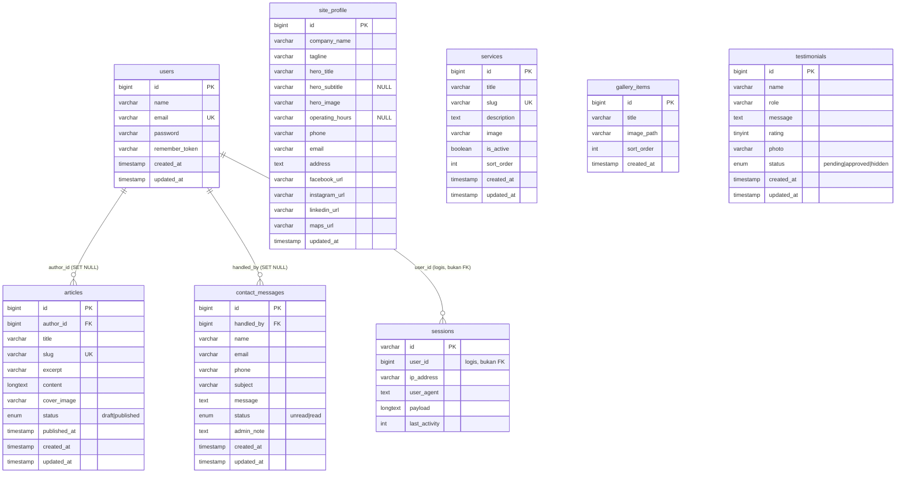

# ERD — Website Company Profile PT. Central Saga Mandala

- **Versi:** 1.1 (selaras dengan PRD v3.5)
- **Tanggal:** 2026-10-17
- **Database:** MySQL 8, engine InnoDB, charset `utf8mb4`, collation `utf8mb4_unicode_ci`
- **Konvensi:** tabel plural snake_case, PK `id` BIGINT UNSIGNED AUTO_INCREMENT, timestamps `created_at`/`updated_at` kecuali disebut lain
- **Relasi:** hanya dua FK ke `users` (`articles.author_id`, `contact_messages.handled_by`). `sessions.user_id` adalah relasi logis, bukan FK (bawaan Laravel). Tabel konten lain independen.

---

## 1. Daftar Tabel

| Tabel | Peran | Baris Ekspektasi |
|-------|-------|------------------|
| `users` | Auth admin, author artikel, handler pesan | 1+ |
| `sessions` | Session driver (`SESSION_DRIVER=database`) | 0..n |
| `site_profile` | Profil usaha (selalu 1 baris) | 1 |
| `services` | Layanan | 0..n |
| `gallery_items` | Galeri / portofolio | 0..n |
| `testimonials` | Testimoni | 0..n |
| `articles` | Artikel / pengumuman | 0..n |
| `contact_messages` | Pesan kontak | 0..n |

**Tabel yang dibuang** (tidak dibuat): `cache`, `cache_locks`, `jobs`, `job_batches`, `failed_jobs`, `password_reset_tokens`.

**Wajib dihapus manual** (bukan hanya tidak dibuat, karena Laravel 12 menyertakannya di skeleton):
- `database/migrations/0001_01_01_000001_create_cache_table.php`
- `database/migrations/0001_01_01_000002_create_jobs_table.php`

Kedua file ini harus dihapus **sebelum** `php artisan migrate` pertama. Tanpa langkah ini, tabel `cache`, `cache_locks`, `jobs`, `job_batches`, `failed_jobs` tetap terbuat meski `.env` menyetel `CACHE_STORE=file` dan `QUEUE_CONNECTION=sync`.

---

## 2. Diagram Relasi (Mermaid)

GitHub dan GitLab merender Mermaid langsung di README. Simpan blok ini di `docs/erd.md` atau README.



**Diagram ASCII (cadangan, untuk terminal):**

```
┌────────────────┐
│     users      │
├────────────────┤
│ id (PK)        │
│ name           │
│ email (UQ)     │
│ password       │
│ remember_token │
│ created_at     │
│ updated_at     │
└──────┬─────────┘
       │
       ├──────────────────────────┐
       │ (1..n, SET NULL)         │ (1..n, SET NULL)
       ▼                          ▼
┌────────────────┐        ┌────────────────────┐
│    articles    │        │  contact_messages  │
├────────────────┤        ├────────────────────┤
│ id (PK)        │        │ id (PK)            │
│ author_id (FK) │        │ handled_by (FK)    │
│ title          │        │ name               │
│ slug (UQ)      │        │ email              │
│ excerpt        │        │ phone              │
│ content        │        │ subject            │
│ cover_image    │        │ message            │
│ status         │        │ status             │
│ published_at   │        │ admin_note         │
│ created_at     │        │ created_at         │
│ updated_at     │        │ updated_at         │
└────────────────┘        └────────────────────┘

┌────────────────┐   ┌────────────────┐   ┌────────────────┐
│  site_profile  │   │    services    │   │ gallery_items  │
│ (selalu 1)     │   │                │   │                │
├────────────────┤   ├────────────────┤   ├────────────────┤
│ id (PK)        │   │ id (PK)        │   │ id (PK)        │
│ company_name   │   │ title          │   │ title          │
│ tagline        │   │ slug (UQ)      │   │ image_path     │
│ hero_title     │   │ description    │   │ sort_order     │
│ hero_subtitle  │   │ image          │   │ created_at     │
│ hero_image     │   │ is_active      │   └────────────────┘
│ operating_hours│   │ sort_order     │
│ phone          │   │ created_at     │   ┌────────────────┐
│ email          │   │ updated_at     │   │  testimonials  │
│ address        │   └────────────────┘   ├────────────────┤
│ facebook_url   │                        │ id (PK)        │
│ instagram_url  │                        │ name           │
│ linkedin_url   │                        │ role           │
│ maps_url       │                        │ message        │
│ updated_at     │                        │ rating         │
└────────────────┘                        │ photo          │
                                          │ status         │
┌────────────────┐                        │ created_at     │
│    sessions    │                        │ updated_at     │
├────────────────┤                        └────────────────┘
│ id (PK, str)   │
│ user_id (idx)  │  ← relasi logis, bukan FK
│ ip_address     │
│ user_agent     │
│ payload        │
│ last_activity  │
└────────────────┘
```

---

## 3. Detail Tabel

### 3.1 `users`

Modifikasi dari migration bawaan Laravel 12:
- `email_verified_at` **dibuang** (tidak ada verifikasi email).
- `remember_token` **dipertahankan** (fitur remember me).
- Tabel `password_reset_tokens` **dibuang**.
- Tabel `sessions` **dipertahankan** (Session driver database).

| Kolom | Tipe | Constraint | Default | Catatan |
|-------|------|-----------|---------|---------|
| id | BIGINT UNSIGNED | PK, AUTO_INCREMENT | — | — |
| name | VARCHAR(100) | NOT NULL | — | — |
| email | VARCHAR(150) | NOT NULL, UNIQUE | — | — |
| password | VARCHAR(255) | NOT NULL | — | bcrypt |
| remember_token | VARCHAR(100) | NULL | NULL | — |
| created_at | TIMESTAMP | NULL | NULL | — |
| updated_at | TIMESTAMP | NULL | NULL | — |

**Index:** `email` (unique).

---

### 3.2 `sessions`

Bawaan Laravel (`SESSION_DRIVER=database`).

| Kolom | Tipe | Constraint | Default | Catatan |
|-------|------|-----------|---------|---------|
| id | VARCHAR(255) | PK | — | — |
| user_id | BIGINT UNSIGNED | NULL, INDEX | NULL | **Relasi logis, bukan FK** (bawaan Laravel) |
| ip_address | VARCHAR(45) | NULL | NULL | — |
| user_agent | TEXT | NULL | NULL | — |
| payload | LONGTEXT | NOT NULL | — | — |
| last_activity | INT | INDEX | — | Unix timestamp |

---

### 3.3 `site_profile` (selalu 1 baris)

Tanpa `created_at` (baris dibuat seeder). Model wajib `protected $table = 'site_profile'` dan `const CREATED_AT = null`.

| Kolom | Tipe | Constraint | Default | Catatan |
|-------|------|-----------|---------|---------|
| id | BIGINT UNSIGNED | PK, AUTO_INCREMENT | — | — |
| company_name | VARCHAR(150) | NOT NULL | — | — |
| tagline | VARCHAR(255) | NOT NULL | — | — |
| hero_title | VARCHAR(255) | NOT NULL | — | — |
| hero_subtitle | VARCHAR(500) | **NULL** | NULL | Menunggu konfirmasi klien |
| hero_image | VARCHAR(255) | NULL | NULL | Path relatif di `storage/app/public/profile/` |
| operating_hours | VARCHAR(255) | **NULL** | NULL | Menunggu konfirmasi klien |
| phone | VARCHAR(30) | NULL | NULL | — |
| email | VARCHAR(150) | NULL | NULL | — |
| address | TEXT | NULL | NULL | — |
| facebook_url | VARCHAR(255) | NULL | NULL | — |
| instagram_url | VARCHAR(255) | NULL | NULL | — |
| linkedin_url | VARCHAR(255) | NULL | NULL | — |
| maps_url | VARCHAR(255) | NULL | NULL | — |
| updated_at | TIMESTAMP | NULL | NULL | — |

---

### 3.4 `services` (tanpa `icon`)

| Kolom | Tipe | Constraint | Default | Catatan |
|-------|------|-----------|---------|---------|
| id | BIGINT UNSIGNED | PK, AUTO_INCREMENT | — | — |
| title | VARCHAR(150) | NOT NULL | — | — |
| slug | VARCHAR(180) | NOT NULL, UNIQUE | — | Auto dari title, editable |
| description | TEXT | NOT NULL | — | — |
| image | VARCHAR(255) | NULL | NULL | Path relatif di `storage/app/public/services/` |
| is_active | BOOLEAN | NOT NULL | 1 | — |
| sort_order | INT | NOT NULL | 0 | Urutan naik |
| created_at | TIMESTAMP | NULL | NULL | — |
| updated_at | TIMESTAMP | NULL | NULL | — |

**Index:** `slug` (unique), `(is_active, sort_order)`.

---

### 3.5 `gallery_items` (tanpa `updated_at`)

Model wajib `const UPDATED_AT = null`.

| Kolom | Tipe | Constraint | Default | Catatan |
|-------|------|-----------|---------|---------|
| id | BIGINT UNSIGNED | PK, AUTO_INCREMENT | — | — |
| title | VARCHAR(150) | NULL | NULL | — |
| image_path | VARCHAR(255) | NOT NULL | — | Path relatif di `storage/app/public/gallery/` |
| sort_order | INT | NOT NULL | 0 | — |
| created_at | TIMESTAMP | NULL | NULL | — |

**Index:** `sort_order`.

---

### 3.6 `testimonials`

| Kolom | Tipe | Constraint | Default | Catatan |
|-------|------|-----------|---------|---------|
| id | BIGINT UNSIGNED | PK, AUTO_INCREMENT | — | — |
| name | VARCHAR(100) | NOT NULL | — | — |
| role | VARCHAR(150) | NOT NULL | — | Jabatan + perusahaan |
| message | TEXT | NOT NULL | — | — |
| rating | TINYINT UNSIGNED | NOT NULL | 5 | 1..5 |
| photo | VARCHAR(255) | NULL | NULL | Path relatif di `storage/app/public/testimonials/` |
| status | ENUM('pending','approved','hidden') | NOT NULL | 'pending' | — |
| created_at | TIMESTAMP | NULL | NULL | — |
| updated_at | TIMESTAMP | NULL | NULL | — |

**Index:** `(status, created_at)` gabungan. Query home `where status='approved' order by created_at desc limit 3` memakai index ini secara langsung. Kolom `status` tunggal tidak perlu index terpisah karena sudah jadi prefix index gabungan.

---

### 3.7 `articles`

| Kolom | Tipe | Constraint | Default | Catatan |
|-------|------|-----------|---------|---------|
| id | BIGINT UNSIGNED | PK, AUTO_INCREMENT | — | — |
| author_id | BIGINT UNSIGNED | NULL, FK → `users.id` ON DELETE SET NULL | NULL | Diisi otomatis `auth()->id()` saat create |
| title | VARCHAR(200) | NOT NULL | — | — |
| slug | VARCHAR(220) | NOT NULL, UNIQUE | — | Auto, editable |
| excerpt | VARCHAR(500) | NOT NULL | — | — |
| content | LONGTEXT | NOT NULL | — | Textarea, escape di Blade |
| cover_image | VARCHAR(255) | NULL | NULL | Path relatif di `storage/app/public/articles/` |
| status | ENUM('draft','published') | NOT NULL | 'draft' | — |
| published_at | TIMESTAMP | NULL | NULL | Auto-set saat pertama publish |
| created_at | TIMESTAMP | NULL | NULL | — |
| updated_at | TIMESTAMP | NULL | NULL | — |

**Index:** `slug` (unique), `(status, published_at)`, `author_id`.

**Relasi model:** `belongsTo(User::class, 'author_id')`.

---

### 3.8 `contact_messages`

| Kolom | Tipe | Constraint | Default | Catatan |
|-------|------|-----------|---------|---------|
| id | BIGINT UNSIGNED | PK, AUTO_INCREMENT | — | — |
| handled_by | BIGINT UNSIGNED | NULL, FK → `users.id` ON DELETE SET NULL | NULL | Diisi otomatis `auth()->id()` saat admin simpan note / tandai read |
| name | VARCHAR(100) | NOT NULL | — | Data pribadi |
| email | VARCHAR(150) | NOT NULL | — | Data pribadi |
| phone | VARCHAR(30) | NULL | NULL | Data pribadi |
| subject | VARCHAR(200) | NOT NULL | — | — |
| message | TEXT | NOT NULL | — | Data pribadi |
| status | ENUM('unread','read') | NOT NULL | 'unread' | — |
| admin_note | TEXT | NULL | NULL | Catatan tindak lanjut |
| created_at | TIMESTAMP | NULL | NULL | — |
| updated_at | TIMESTAMP | NULL | NULL | — |

**Index:** `status`, `created_at`, `handled_by`.

**Relasi model:** `belongsTo(User::class, 'handled_by')`.

**Catatan privasi:** kolom `name`, `email`, `phone`, `message` adalah data pribadi pengirim. Hanya diakses admin lewat `/admin/pesan`, dan bisa dihapus per record. Tidak diekspos ke halaman publik mana pun.

---

## 4. Relasi

Hanya dua relasi database-level:

- `articles.author_id` → `users.id` (`ON DELETE SET NULL`). Satu user bisa menulis banyak artikel. Menghapus user tidak menghapus artikel, hanya mengosongkan author.
- `contact_messages.handled_by` → `users.id` (`ON DELETE SET NULL`). Satu user bisa menangani banyak pesan. Menghapus user tidak menghapus pesan, hanya mengosongkan handler.

**Relasi logis (bukan FK):** `sessions.user_id` → `users.id`. Ini bawaan Laravel: session disimpan di tabel terpisah dan `user_id` sengaja tidak diberi constraint FK agar session tidak ikut terhapus saat user dihapus. Satu kalimat ini menghindari pertanyaan "kenapa tidak ada FK di `sessions`".

Tabel konten lain (`site_profile`, `services`, `gallery_items`, `testimonials`) independen, tidak butuh FK karena tidak ada join antar section.

---

## 5. Model Eloquent (Wajib)

Tanpa konfigurasi ini, Eloquent akan error `table site_profiles not found` atau `column created_at not found`.

| Model | `protected $table` | `const CREATED_AT` | `const UPDATED_AT` |
|-------|--------------------|--------------------|--------------------|
| `User` | (default) | `'created_at'` | `'updated_at'` |
| `SiteProfile` | `'site_profile'` | `null` | `'updated_at'` |
| `Service` | (default) | `'created_at'` | `'updated_at'` |
| `GalleryItem` | (default) | `'created_at'` | `null` |
| `Testimonial` | (default) | `'created_at'` | `'updated_at'` |
| `Article` | (default) | `'created_at'` | `'updated_at'` |
| `ContactMessage` | (default) | `'created_at'` | `'updated_at'` |

Contoh:

```php
class SiteProfile extends Model
{
    protected $table = 'site_profile';
    const CREATED_AT = null;
    protected $fillable = [
        'company_name','tagline','hero_title','hero_subtitle',
        'hero_image','operating_hours','phone','email','address',
        'facebook_url','instagram_url','linkedin_url','maps_url',
    ];
}

class GalleryItem extends Model
{
    const UPDATED_AT = null;
    protected $fillable = ['title','image_path','sort_order'];
}

class Article extends Model
{
    protected $fillable = [
        'author_id','title','slug','excerpt','content',
        'cover_image','status','published_at',
    ];
    protected $casts = ['published_at' => 'datetime'];

    public function author(): BelongsTo
    {
        return $this->belongsTo(User::class, 'author_id');
    }
}

class ContactMessage extends Model
{
    protected $fillable = [
        'handled_by','name','email','phone','subject',
        'message','status','admin_note',
    ];

    public function handler(): BelongsTo
    {
        return $this->belongsTo(User::class, 'handled_by');
    }
}
```

---

## 6. Migration Order

`php artisan migrate` menjalankan sesuai timestamp. Urutan yang benar:

1. `0001_01_01_000000_create_users_table.php` — dimodifikasi (tanpa `email_verified_at`, tanpa `password_reset_tokens`, tabel `sessions` dipertahankan)
2. `YYYY_MM_DD_HHMMSS_create_site_profile_table.php`
3. `YYYY_MM_DD_HHMMSS_create_services_table.php`
4. `YYYY_MM_DD_HHMMSS_create_gallery_items_table.php`
5. `YYYY_MM_DD_HHMMSS_create_testimonials_table.php`
6. `YYYY_MM_DD_HHMMSS_create_articles_table.php` — FK ke `users` (harus setelah `users`)
7. `YYYY_MM_DD_HHMMSS_create_contact_messages_table.php` — FK ke `users` (harus setelah `users`)

**File migrasi bawaan yang WAJIB DIHAPUS sebelum `php artisan migrate`:**

```
database/migrations/0001_01_01_000001_create_cache_table.php
database/migrations/0001_01_01_000002_create_jobs_table.php
```

Kedua file ini disertakan Laravel 12 secara default. Jika tidak dihapus, tabel `cache`, `cache_locks`, `jobs`, `job_batches`, `failed_jobs` tetap terbuat meski `.env` menyetel `CACHE_STORE=file` dan `QUEUE_CONNECTION=sync`.

**Cache config:** kalau `.env` diubah (mis. `SESSION_DRIVER`, `APP_TIMEZONE`), jalankan `php artisan config:clear` atau `php artisan optimize:clear`. **Bukan** `php artisan cache:clear`, karena `cache:clear` hanya membersihkan cache aplikasi (key-value), bukan cache config.

---

## 7. Seeder

Seeder idempotent **dan** aman diulang di production, dengan guard keberadaan (bukan `firstOrCreate` by key).

| Seeder | Isi | Guard |
|--------|-----|-------|
| `AdminSeeder` | 1 user dari `ADMIN_NAME`, `ADMIN_EMAIL`, `ADMIN_PASSWORD` | **Berhenti jika `User::exists()`** (return early, tidak membuat admin kedua). **Lempar `RuntimeException`** jika `ADMIN_PASSWORD` kosong atau < 8 karakter, dan jika `APP_ENV=production` dan password bernilai `password` atau `secret`. |
| `SiteProfileSeeder` | 1 baris `site_profile` (Section 3.3); `hero_subtitle` dan `operating_hours` = NULL | **Berhenti jika `SiteProfile::exists()`** (return early). Mencegah baris kedua saat admin mengganti `company_name` di dashboard. |
| `DatabaseSeeder` | Panggil `AdminSeeder` + `SiteProfileSeeder` | — |

`DemoSeeder` (opsional, terpisah, **tidak** dipanggil default): 5 layanan usulan `[CONTOH]`, 2 artikel `[CONTOH]`, 1 testimoni `approved` `[CONTOH]`.

**Setelah seeding pertama di production:** hapus `ADMIN_PASSWORD` dari `.env` (kosongkan nilainya). Ini mencegah seeder membuat admin baru dengan password yang sama jika seeder dijalankan ulang. Guard `User::exists()` sudah mencegah pembuatan admin kedua, tapi mengosongkan `ADMIN_PASSWORD` adalah lapisan kedua.

---

## 8. Query Pattern (Referensi Implementasi)

| Kebutuhan | Query | Index yang dipakai |
|-----------|-------|---------------------|
| Home hero | `SiteProfile::first()` | PK |
| Layanan publik | `Service::where('is_active',1)->orderBy('sort_order')->orderBy('id')->get()` | `(is_active, sort_order)` |
| Galeri home | `GalleryItem::orderBy('sort_order')->orderBy('id')->limit(6)->get()` | `sort_order` |
| Galeri page | `GalleryItem::orderBy('sort_order')->orderBy('id')->get()` | `sort_order` |
| Testimoni home | `Testimonial::where('status','approved')->latest()->limit(3)->get()` | `(status, created_at)` |
| Artikel home | `Article::where('status','published')->orderByDesc('published_at')->limit(3)->get()` | `(status, published_at)` |
| Artikel list | `Article::where('status','published')->orderByDesc('published_at')->paginate(10)` | `(status, published_at)` |
| Artikel detail | `Article::where('slug',$slug)->where('status','published')->firstOrFail()` | `slug` unique |
| Layanan detail | `Service::where('slug',$slug)->where('is_active',1)->firstOrFail()` | `slug` unique |
| Artikel + author | `Article::with('author')->...` | — |
| Pesan + handler | `ContactMessage::with('handler')->...` | — |
| Dashboard count | `Service::count()`, `GalleryItem::count()`, `Testimonial::where('status','pending')->count()`, `Article::where('status','draft')->count()`, `ContactMessage::where('status','unread')->count()` | — |
| Inbox unread | `ContactMessage::where('status','unread')->latest()->paginate(15)` | `status`, `created_at` |

---

## 9. Catatan Enum

MySQL ENUM dipakai langsung karena jumlah nilai tetap dan kecil:

- `testimonials.status`: `pending`, `approved`, `hidden`
- `articles.status`: `draft`, `published`
- `contact_messages.status`: `unread`, `read`

Jika V2 butuh nilai dinamis, migrasi ke tabel lookup.

---

## 10. Catatan Integritas & Privasi

- **`ON DELETE SET NULL`** pada `articles.author_id` dan `contact_messages.handled_by`: menghapus user tidak menghapus konten.
- **Slug unik** per tabel (`services.slug`, `articles.slug`). Validasi `unique` di FormRequest saat create dan update (kecuali record sendiri).
- **`is_active` + `sort_order`** dipakai untuk kontrol tampil dan urutan tanpa harus hapus record.
- **`status`** di `testimonials`, `articles`, `contact_messages` adalah satu-satunya sumber kebenaran untuk moderasi dan publikasi.
- **`published_at`** di `articles`: auto-set saat draft→published pertama kali (dan null). Saat published→draft, nilai dipertahankan (tidak di-null).
- **File path** di kolom gambar (`image`, `photo`, `cover_image`, `image_path`, `hero_image`) adalah path relatif di `storage/app/public/`. Hapus file fisik saat record dihapus atau saat gambar diganti (`ImageUploader::delete`).
- **Timezone** di `.env` `APP_TIMEZONE=Asia/Makassar`; pastikan `config/app.php` membaca `env('APP_TIMEZONE', 'UTC')`. Cek Hari 1: simpan satu baris, lihat `updated_at` di DB apakah WITA.
- **Seeder guard** di `AdminSeeder` melindungi dari akun admin tanpa password. `User::exists()` dan `SiteProfile::exists()` mencegah duplikasi saat seeder diulang.
- **Privasi data kontak:** kolom `name`, `email`, `phone`, `message` di `contact_messages` adalah data pribadi pengirim. Hanya diakses admin lewat `/admin/pesan`, bisa dihapus per record. Tidak diekspos ke halaman publik, tidak dikirim ke layanan pihak ketiga. Catat ini di README.
- **`sessions.user_id` tidak diberi FK** karena bawaan Laravel: session harus tetap ada saat user dihapus (mis. user logout terpaksa). Ini bukan bug.

---

## 11. Checklist Hari 1 (Migrasi & Seeder)

- [ ] **Hapus** `database/migrations/0001_01_01_000001_create_cache_table.php`
- [ ] **Hapus** `database/migrations/0001_01_01_000002_create_jobs_table.php`
- [ ] Modifikasi `0001_01_01_000000_create_users_table.php`: hapus `email_verified_at`, hapus blok `password_reset_tokens`, **pertahankan** tabel `sessions`
- [ ] Buat migrasi `site_profile`, `services`, `gallery_items`, `testimonials`, `articles`, `contact_messages` sesuai Section 3
- [ ] FK `articles.author_id` dan `contact_messages.handled_by` → `users.id` `ON DELETE SET NULL`
- [ ] Index sesuai Section 3: `services.slug` (unique), `services.(is_active, sort_order)`, `gallery_items.sort_order`, `testimonials.(status, created_at)`, `articles.slug` (unique), `articles.(status, published_at)`, `articles.author_id`, `contact_messages.status`, `contact_messages.created_at`, `contact_messages.handled_by`
- [ ] `AdminSeeder` memakai guard `User::exists()` + validasi password (kosong, < 8, `password`/`secret` saat production)
- [ ] `SiteProfileSeeder` memakai guard `SiteProfile::exists()`
- [ ] `SiteProfileSeeder` membuat 1 baris dengan `hero_subtitle = NULL` dan `operating_hours = NULL`
- [ ] Model `SiteProfile` punya `$table = 'site_profile'` + `const CREATED_AT = null`
- [ ] Model `GalleryItem` punya `const UPDATED_AT = null`
- [ ] Model `Article` dan `ContactMessage` punya relasi `belongsTo(User::class, ...)` masing-masing
- [ ] `php artisan migrate` berhasil, **tanpa** tabel `cache`, `cache_locks`, `jobs`, `job_batches`, `failed_jobs`, `password_reset_tokens`
- [ ] `php artisan db:seed` berhasil, **tidak** error guard password
- [ ] Jalankan `php artisan db:seed` **kedua kali**: tidak ada error, tidak ada user kedua, tidak ada baris `site_profile` kedua
- [ ] Simpan 1 baris `site_profile`, cek `updated_at` di DB = WITA (bukan UTC)
- [ ] Setelah seeding pertama di production: kosongkan `ADMIN_PASSWORD` di `.env`
- [ ] Catat di README: data pribadi di `contact_messages` hanya diakses admin, bisa dihapus per record
